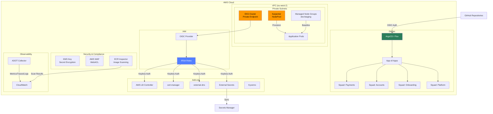

# SecondWave Container Platform — EKS + Karpenter + GitOps

**Reference AWS EKS container platform for open banking workloads.**

## Scenario: SecondWave Financial

SecondWave is a UK-based fintech building an open banking platform with 4 autonomous squads:

| Squad | Domain | Workload Pattern |
|-------|--------|-----------------|
| **Payments** | Real-time payment processing | High-throughput, latency-sensitive |
| **Accounts** | Account aggregation & ledger | Stateful, DynamoDB-backed |
| **Onboarding** | KYC/AML verification | Batch, GPU-accelerated |
| **Platform** | Shared infrastructure & CI/CD | Control plane, GitOps |

**Requirements:**
- PCI-DSS & Open Banking Standard compliance
- Multi-squad isolation with shared cluster
- Sub-minute node provisioning for batch workloads
- Keyless pod authentication to AWS services
- GitOps-driven deployments with squad autonomy

## Architecture



## Architecture Decisions

| ID | Decision | Rationale |
|----|----------|-----------|
| ADR-001 | **Karpenter over Cluster Autoscaler** | Sub-second node provisioning, instance right-sizing, no ASG state management |
| ADR-002 | **External Secrets over CSI Driver** | Native K8s secrets (env/volume), push-based sync, no CSI knowledge required |
| ADR-003 | **Private EKS Endpoint** | No public internet exposure, PCI-DSS alignment, reduced attack surface |
| ADR-004 | **IRSA over Static Keys** | Keyless pod authentication, per-SA IAM roles, CloudTrail audit trail |

## Components

### Cluster
- **EKS 1.28** — Private endpoint only, KMS-encrypted secrets, all control plane logs
- **Managed Node Groups** — Spot instances for dev/staging, on-demand for prod baseline
- **Karpenter** — Group-less auto-provisioning with consolidation (prod)

### GitOps
- **ArgoCD** (default) or **Flux** — App-of-apps bootstrap pattern
- Each squad owns their application repository
- Cluster add-ons managed by platform team

### Add-ons
- **AWS Load Balancer Controller** — ALB/NLB provisioning via Ingress/Service
- **cert-manager** — Let's Encrypt automated TLS with DNS01 challenge
- **external-dns** — Automatic Route53 record creation
- **External Secrets Operator** — AWS Secrets Manager sync (push-based)
- **Kyverno** — Pod Security Standards enforcement (restricted profile)
- **Karpenter** — EC2NodeClass + NodePool for dynamic provisioning
- **AWS WAF** — WebACL with OWASP managed rules, rate limiting

### Security
- **IRSA** — OIDC-federated IAM roles, no static credentials
- **KMS** — Customer-managed key for etcd secret encryption
- **ECR Inspector** — Continuous container image scanning
- **Kyverno Policies** — Restricted pod security, image origin enforcement

### Observability
- **ADOT Collector** — Metrics, traces, logs via OpenTelemetry
- **CloudWatch** — Container Insights, dashboard, alarms
- **AWS X-Ray** — Distributed tracing for application performance

## Repository Structure

```
aws/container-platform/
├── main.tf                  # Root module
├── variables.tf             # All input variables
├── outputs.tf               # Cluster outputs
├── versions.tf              # Provider constraints
├── terraform.tfvars.example # Example configuration
├── modules/
│   ├── eks-cluster/         # EKS with private endpoint, KMS, node groups
│   ├── karpenter/           # Karpenter provisioner, IAM, EC2NodeClass
│   ├── irsa/                # IAM roles for service accounts
│   ├── gitops-bootstrap/    # ArgoCD/Flux Helm deployment
│   └── addons/              # ALB controller, cert-manager, ESO, Kyverno
├── .github/workflows/
│   ├── eks-deploy.yml       # OIDC-authenticated Terraform CI/CD
│   └── gitops-sync.yml      # ArgoCD app-of-apps validation
├── docs/
│   ├── ADR/                 # Architecture Decision Records
│   └── runbooks/            # Recovery and troubleshooting guides
├── observability/
│   ├── adot-collector.yaml  # OpenTelemetry DaemonSet
│   └── cluster-dashboard.json
├── tests/
│   ├── eks_test.go          # Terratest for cluster validation
│   └── addons_test.go       # Terratest for add-on Helm charts
├── scripts/
│   └── bootstrap-backend.sh # S3 + DynamoDB state backend
├── .tflint.hcl
├── .checkov.yml
├── .pre-commit-config.yaml
├── .infracost.yml
├── .tool-versions
└── .editorconfig
```

## Deployment

### Prerequisites

```bash
# Install tools (via asdf recommended)
asdf install

# Or manually install:
# - Terraform >= 1.5
# - AWS CLI v2
# - kubectl, helm, argocd (or flux)

# Configure AWS credentials (must have permissions for EKS, IAM, EC2)
aws configure
```

### Step 1: Bootstrap State Backend

```bash
chmod +x scripts/bootstrap-backend.sh
./scripts/bootstrap-backend.sh prod eu-west-2
```

### Step 2: Configure Variables

```bash
cp terraform.tfvars.example terraform.tfvars
# Edit terraform.tfvars with your environment values
```

### Step 3: Deploy

```bash
terraform init
terraform plan -var-file=terraform.tfvars
terraform apply -var-file=terraform.tfvars
```

### Step 4: Configure kubectl

```bash
aws eks update-kubeconfig --name secondwave-prod-euw2 --region eu-west-2
kubectl get nodes
kubectl get pods -A
```

## Production Safeguards

| Safeguard | Implementation |
|-----------|---------------|
| **No public API** | `cluster_endpoint_public_access = false` |
| **Secret encryption** | KMS customer-managed key for etcd |
| **Keyless auth** | IRSA — no AWS credentials in pods |
| **Admission control** | Kyverno — restricted pod security |
| **Image scanning** | ECR Inspector on every push |
| **WAF** | AWS managed rules + rate limiting |
| **State encryption** | S3 SSE + DynamoDB locking |
| **CI/CD auth** | GitHub OIDC — no static secrets |
| **Logging** | All control plane logs to CloudWatch |
| **Retention** | 90 days CloudWatch, 7 years S3 Glacier |

## Trade-offs

| Decision | Benefit | Cost |
|----------|---------|------|
| Private endpoint | Security (no public API) Requires VPN/Direct Connect for kubectl |
| Karpenter | Fast provisioning, cost optimization | Newer technology, requires specific expertise |
| ArgoCD | Rich UI, app-of-apps pattern | CRD complexity, more RBAC than Flux |
| External Secrets | Native K8s secrets, push-based | Secret duplication (AWS + etcd), sync window |
| Kyverno | YAML policies (no Rego) | Less mature policy ecosystem than OPA |

## Observability

### Metrics Pipeline

```
Pod/Node Metrics → ADOT Collector → CloudWatch Container Insights
                                    → Amazon Managed Prometheus (optional)
Application Traces → OpenTelemetry  → AWS X-Ray
Control Plane Logs → EKS → CloudWatch Logs → SIEM (Splunk)
```

### Key Dashboards
- **Cluster Overview** — Node count, pod status, API server metrics
- **Karpenter** — Pending pods, node claims, consolidation events
- **Cost Optimization** — Spot vs on-demand ratio, right-sizing savings

## Disaster Recovery

| Scenario | RTO | Response |
|----------|-----|----------|
| Control plane failure | ~15 min | AWS auto-recovery (3 AZ) |
| Accidental cluster deletion | 4 hours | Terraform re-apply |
| etcd corruption | N/A (managed) | AWS handles automatically |
| Regional outage | 4 hours | Deploy to DR region (Ireland) |

See [EKS Cluster Recovery Runbook](docs/runbooks/eks-cluster-recovery.md) for detailed procedures.

## Local Development

```bash
# Initialize pre-commit hooks
pre-commit install --hook-type pre-commit --hook-type commit-msg

# Run linters locally
pre-commit run --all-files

# Run security scan
checkov -d .

# Cost estimation
infracost breakdown --path .

# Terratest
cd tests
go test -tags=terratest -v -timeout 60m -run TestAddonHelmCharts
```

## Contributing

1. Fork the repository
2. Create a feature branch (`feat/your-feature`)
3. Run `pre-commit run --all-files`
4. Create a pull request with architecture decision documentation

## License

Internal — SecondWave Financial Platform Engineering
